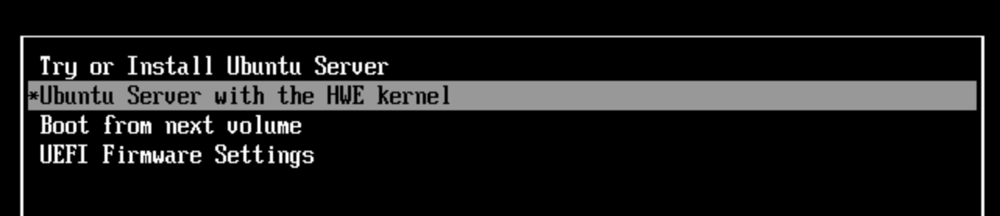
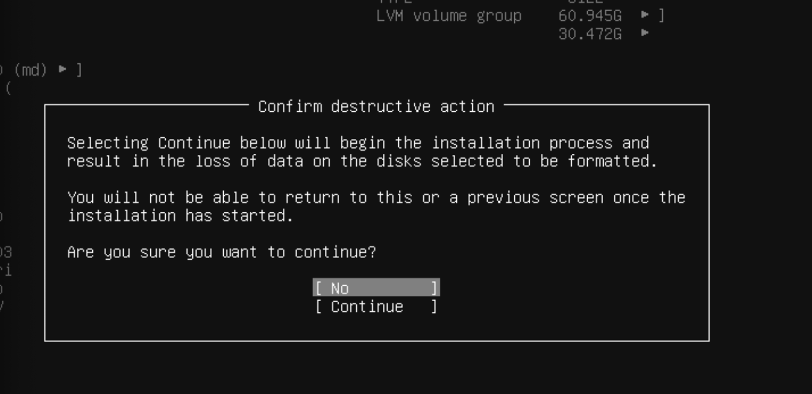
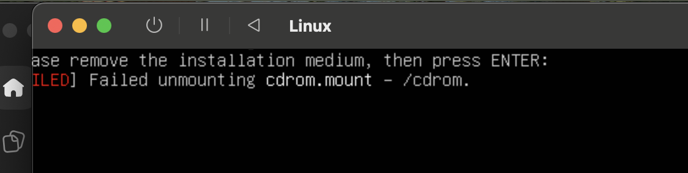
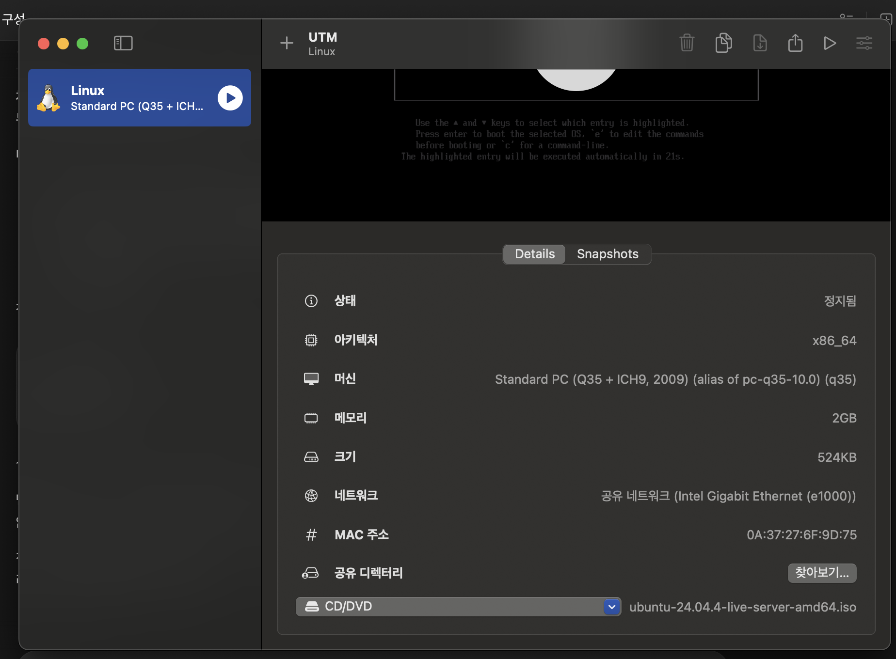
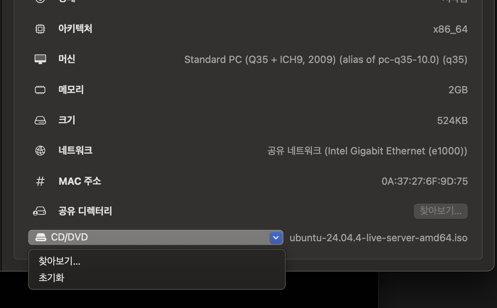

# linuxVM 설치방법

Intel MacBook에서 UTM으로 Ubuntu Server 가상머신을 만들고, 설치 후 Ubuntu로 부팅하는 방법입니다. 실제 설치 과정에서 확인한 화면과 재부팅 문제 해결 방법을 함께 정리했습니다.

작성일: 2026년 11월 1일

## 설치 환경

| 항목 | 사용한 환경 |
|---|---|
| 호스트 컴퓨터 | Intel MacBook |
| 호스트 운영체제 | macOS |
| 가상머신 프로그램 | UTM |
| 설치 운영체제 | Ubuntu Server 24.04.4 LTS |
| 설치 파일 | `ubuntu-24.04.4-live-server-amd64.iso` |
| 가상머신 이름 | `Linux` |
| 가상머신 아키텍처 | `x86_64` |
| 가상머신 메모리 | 2GB |
| 가상머신 네트워크 | 공유 네트워크 |

이 문서는 **UTM 안의 가상 디스크에 Ubuntu를 설치하는 과정**을 다룹니다. Mac의 운영체제를 Ubuntu로 교체하는 베어메탈 설치나 듀얼 부팅 절차가 아닙니다.

## 1. UTM 설치

1. [UTM 공식 사이트](https://getutm.app/)에 접속합니다.
2. **Download for Mac**으로 설치 파일을 내려받습니다.
3. `.dmg` 파일을 엽니다.
4. UTM을 **Applications** 폴더로 옮긴 뒤 실행합니다.

UTM은 Mac 안에서 다른 운영체제를 가상머신으로 실행하는 프로그램입니다. 공식 사이트 배포판은 무료이며, App Store 배포판은 유료입니다.

## 2. Ubuntu Server 설치 ISO 다운로드

[Ubuntu 24.04 다운로드 페이지](https://releases.ubuntu.com/24.04/)에서 **Server install image — AMD64**를 내려받습니다. 이 설치 기록에서 사용한 파일은 다음과 같습니다.

```text
ubuntu-24.04.4-live-server-amd64.iso
```

다운로드 페이지에서 제공하는 세부 버전은 달라질 수 있습니다.

| 이름 | 의미 |
|---|---|
| `live-server` | Ubuntu Server 설치용 이미지. 설치하면 가상 디스크에 저장하여 계속 사용할 수 있습니다. |
| `desktop` | 바탕화면과 창 등 그래픽 환경이 포함된 Ubuntu 설치용 이미지. |
| `amd64` | Intel·AMD의 64비트 CPU용 아키텍처. Intel MacBook에서도 이 버전을 사용합니다. |
| `.iso` | 운영체제 설치 디스크 이미지 파일. |

이번 목적은 서버 실행 환경을 만드는 것이므로 **Server 이미지**를 사용합니다. Ubuntu Server는 기본적으로 바탕화면 대신 텍스트 터미널을 사용합니다.

Apple Silicon Mac에서 같은 방식으로 가상화하려면 해당 CPU에 맞는 **ARM64 이미지**를 사용해야 합니다.

## 3. UTM에서 Ubuntu 가상머신 생성

UTM에서 다음 순서로 선택합니다.

**`+` → Create a New Virtual Machine → Virtualize → Linux**

1. 설치 이미지 선택 화면에서 다운로드한 Ubuntu `.iso` 파일을 지정합니다.
2. 가상머신에 할당할 메모리와 CPU를 설정합니다.
3. Ubuntu를 설치할 가상 디스크를 생성합니다.
4. 공유 디렉터리 설정은 필요하지 않다면 생략합니다.
5. 가상머신을 저장하고 **▶ 실행**을 누릅니다.

이 설치 기록의 가상머신은 `x86_64`, 메모리 **2GB**, **공유 네트워크**로 설정했습니다. CPU와 가상 디스크 용량은 Mac의 여유 자원과 이후 실행할 애플리케이션에 맞게 정합니다.

설치 ISO는 가상 CD/DVD처럼 연결되어, 첫 부팅에서 Ubuntu 설치 프로그램을 실행합니다.

## 4. 부팅 메뉴에서 Ubuntu 설치 시작

처음 부팅하면 다음 네 가지 항목이 나타납니다.

```text
Try or Install Ubuntu Server
Ubuntu Server with the HWE kernel
Boot from next volume
UEFI Firmware Settings
```



**첫 번째 `Try or Install Ubuntu Server`를 선택하고 Enter를 누릅니다.**

위 스크린샷에서는 두 번째 항목이 선택되어 있습니다. 이 상태라면 UTM 화면을 클릭하고 **위쪽 방향키를 한 번 누른 뒤 Enter**를 누릅니다.

## 5. Ubuntu 설치 설정 진행

설치 프로그램에서 언어, 키보드, 네트워크, 저장소, 사용자 계정 등을 설정합니다. 화면 이동에는 주로 **방향키, Tab, Space, Enter**를 사용합니다.

| 설정 항목 | 진행 방법 |
|---|---|
| 언어·키보드 | 사용할 언어와 키보드 배열 선택 |
| 설치 유형 | 기본 Ubuntu Server 선택 |
| 네트워크 | 별도 설정이 없다면 DHCP 자동 설정 유지 |
| Proxy | 사용하지 않는다면 빈칸 |
| Mirror | 특별한 요구사항이 없다면 기본값 |
| Storage | UTM에서 생성한 가상 디스크를 설치 대상으로 선택 |
| 사용자 계정 | 서버 이름, 사용자 이름, 비밀번호 설정 |
| SSH | 이후 SSH로 접속하려면 `Install OpenSSH server` 선택 |
| 추가 패키지 | 필요한 것이 없다면 선택 없이 진행 |

### 디스크 포맷 확인 화면

저장소 설정 후 아래와 같은 확인창이 나타납니다.



이 화면은 **선택한 디스크를 포맷하고 Ubuntu 설치를 시작할지** 확인하는 단계입니다.

1. 설치 대상이 **UTM에서 새로 만든 가상 디스크**인지 확인합니다.
2. 방향키로 **`Continue`**를 선택합니다.
3. Enter를 눌러 진행합니다.

> 스크린샷처럼 `No`가 선택된 상태에서 Enter를 누르면 설치 진행을 취소합니다. 모든 화면에서 Enter만 누르지 말고, 선택된 항목을 확인해야 합니다.

남은 설치 설정을 마친 뒤, 파일 설치가 끝날 때까지 기다립니다.

## 6. 설치 완료 후 재부팅

설치가 끝나면 **`Reboot Now`**를 선택합니다.

이번 설치에서는 다음 메시지가 나오며 멈춘 것처럼 보였습니다.

```text
Please remove the installation medium, then press ENTER:
Failed unmounting cdrom.mount - /cdrom.
```



화면의 뜻은 **설치 미디어를 꺼낸 뒤 Enter를 누르라**는 것입니다. `/cdrom`은 설치 미디어가 연결된 위치입니다.

이 메시지만으로 Ubuntu 설치가 실패했다고 판단할 수는 없습니다. 이 단계에서는 UTM에서 설치 ISO 연결을 해제하고 재부팅을 진행합니다.

> **VM을 정지하는 것만으로 설치 ISO가 분리되지는 않습니다.** ISO가 계속 연결되어 있으면 재부팅할 때 설치 프로그램으로 다시 들어갈 수 있습니다.

## 7. UTM에서 설치 ISO 연결 해제

검은 Ubuntu 실행 화면을 그대로 두고, **UTM의 가상머신 목록 창**으로 이동합니다.

1. 왼쪽에서 **Linux** 가상머신을 선택합니다.
2. 상세 정보 맨 아래의 **CD/DVD** 항목을 찾습니다.
3. 오른쪽에 연결된 `ubuntu-24.04.4-live-server-amd64.iso` 파일을 확인합니다.



4. **CD/DVD 오른쪽의 파란색 아래 화살표 버튼**을 누릅니다.
5. 열린 메뉴에서 **`초기화`**를 선택합니다.



**이 CD/DVD 메뉴의 `초기화`는 설치 ISO 연결을 비우는 기능입니다. Ubuntu가 설치된 가상 디스크를 포맷하거나 가상머신을 삭제하는 기능이 아닙니다.**

선택 후 ISO 파일명이 사라지는지 확인합니다. 영어 UI에서는 `Clear`로 표시될 수 있습니다.

## 8. 설치된 Ubuntu로 부팅하고 로그인

ISO를 분리한 다음 현재 VM 상태에 맞게 진행합니다.

- **설치 미디어 제거 안내 화면이 열려 있다면:** Ubuntu 화면을 클릭하고 **Enter**를 누릅니다.
- **이미 VM을 정지한 상태라면:** UTM에서 **▶ 실행**을 누릅니다.

이제 설치 ISO 대신 **Ubuntu가 설치된 가상 디스크**로 부팅합니다. 로그인 화면은 다음과 같은 형태입니다.

```text
Ubuntu 24.04 ...
서버이름 login:
```

설치할 때 만든 사용자 이름과 비밀번호로 로그인합니다.

- Ubuntu Server는 기본적으로 **텍스트 로그인 화면**이 나오는 것이 정상입니다.
- 비밀번호 입력 중에는 글자나 `*`가 화면에 표시되지 않습니다.
- 설치 프로그램이 다시 나타나면 CD/DVD에 설치 ISO가 남아 있는지 확인합니다.
- ISO를 분리했는데 부팅 장치를 찾지 못한다면, 재설치하기 전에 가상 디스크 연결과 설치 완료 여부를 확인합니다.

## 설치 중 헷갈렸던 부분

| 상황 | 확인하거나 선택할 내용 |
|---|---|
| 처음 네 가지 부팅 항목이 나옴 | `Try or Install Ubuntu Server` 선택 |
| 포맷 확인창에서 진행되지 않음 | 대상 가상 디스크 확인 후 `No` 대신 `Continue` 선택 |
| `Failed unmounting ... /cdrom`에서 멈춤 | 설치 ISO 연결 해제 후 Enter |
| 재부팅할 때 설치 화면이 반복됨 | UTM의 CD/DVD에 ISO가 남아 있는지 확인 |
| 한국어 메뉴에 `Clear`가 없음 | 해당 CD/DVD 메뉴의 `초기화` 사용 |
| 바탕화면이 나오지 않음 | Ubuntu Server는 기본적으로 터미널 환경 |

## 설치 범위와 다음 단계

완료한 범위는 **UTM 가상머신 생성과 Ubuntu 설치**입니다. K3s 설치는 별도 단계입니다.

Forus의 원래 구성에서는 이 Intel MacBook의 Ubuntu에 **K3s Agent**를 설치하고, Mac Studio의 Linux 환경에 설치할 **K3s Server**에 연결합니다. 두 VM이 서로 통신할 수 있도록 네트워크 설정도 별도로 확인해야 합니다.

## 참고 자료

- [UTM 공식 사이트](https://getutm.app/)
- [UTM macOS 설치 안내](https://docs.getutm.app/installation/macos/)
- [UTM Ubuntu 설치 안내](https://docs.getutm.app/guides/ubuntu/)
- [Ubuntu 24.04 다운로드](https://releases.ubuntu.com/24.04/)
- [Ubuntu Server 설치 안내](https://ubuntu.com/server/docs/tutorial/basic-installation/)
- [UTM 네트워크 설정](https://docs.getutm.app/settings-qemu/devices/network/network/)
